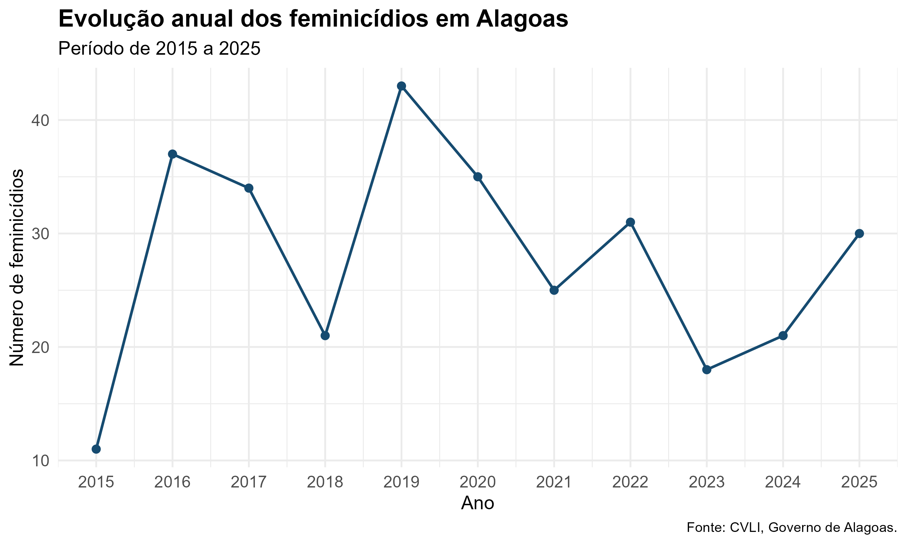
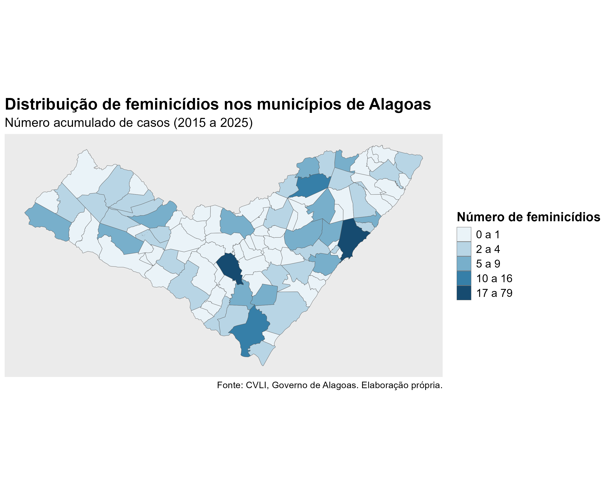
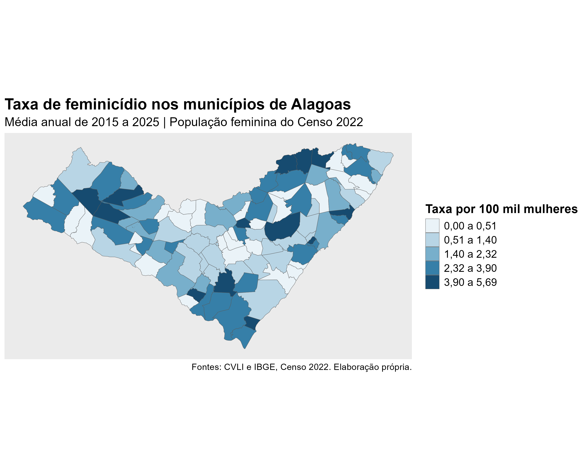
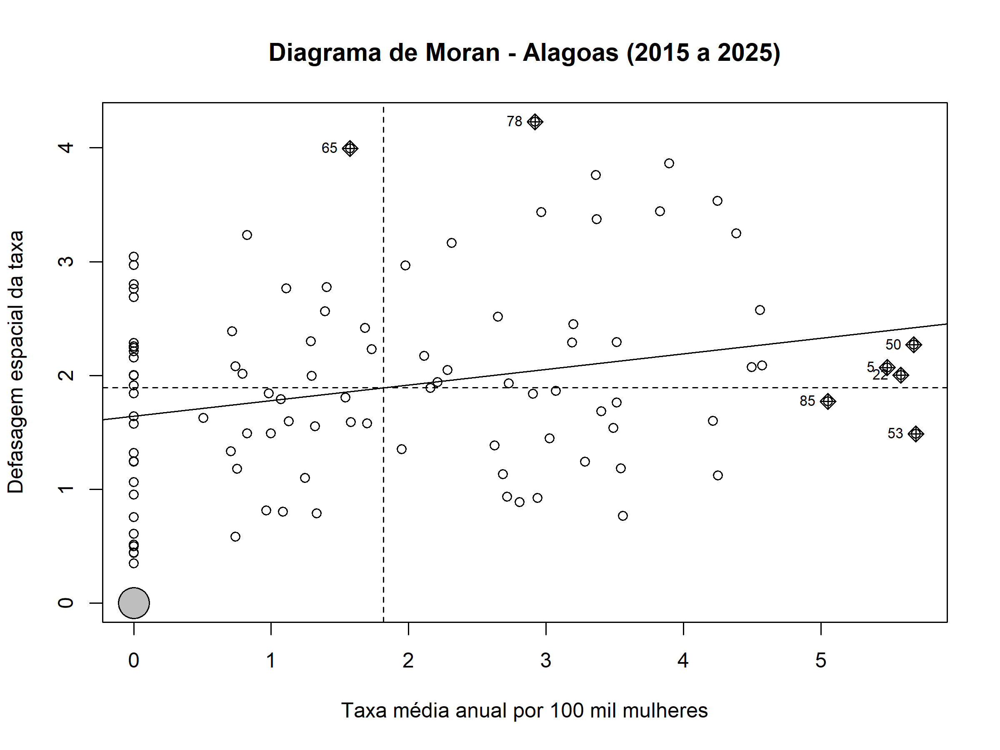
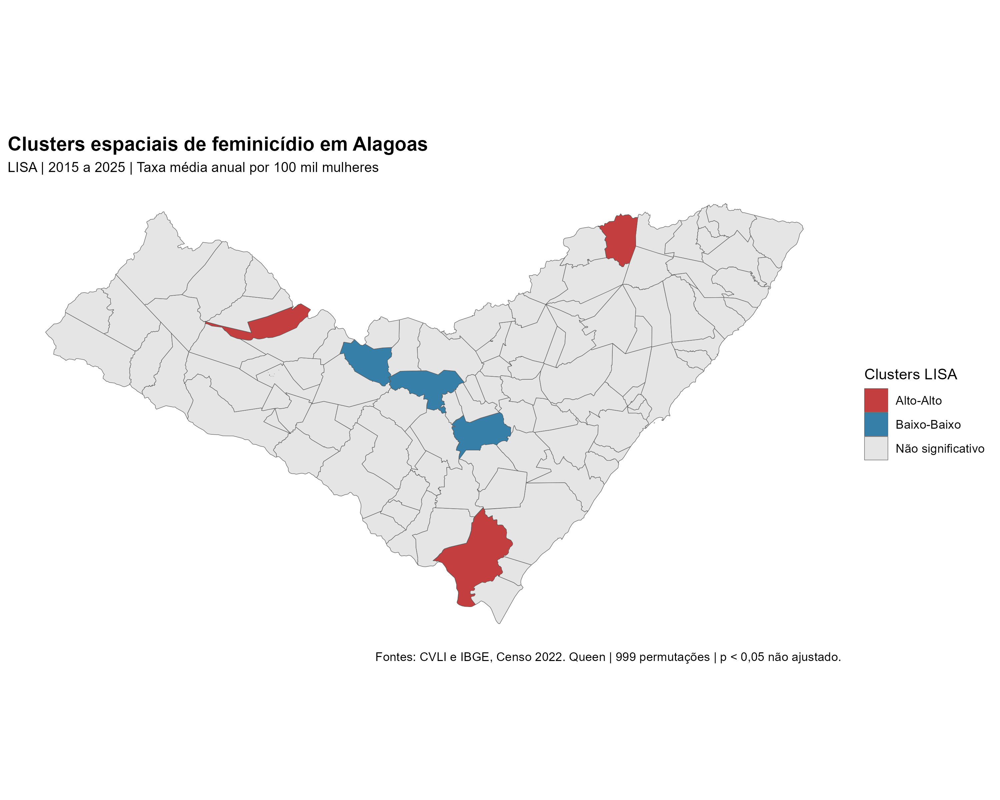

# Análise Espacial dos Feminicídios em Alagoas (2015–2025)

**NEPE | Núcleo de Estudos e Pesquisa Econômica · PET Economia**

Estudo quantitativo e descritivo sobre a evolução temporal, as características dos registros e a distribuição espacial dos feminicídios nos **102 municípios de Alagoas**, entre **2015 e 2025**, utilizando **R** e técnicas de Análise Exploratória de Dados Espaciais (AEDE).

## Visão geral

| Indicador | Resultado |
|:--|--:|
| Feminicídios registrados (2015–2025) | **306** |
| Média anual de registros | **27,8** |
| Municípios analisados | **102** |
| Ano com mais registros | **2019 (43)** |
| Idade média das vítimas com informação disponível | **33,46 anos** |
| Maceió | **79 registros** |
| Arapiraca | **17 registros** |
| União dos Palmares | **12 registros** |

> **Escopo:** os números representam ocorrências classificadas como feminicídio na base administrativa utilizada. Não devem ser confundidos com todos os homicídios de mulheres.

## Objetivos

- Caracterizar os registros por idade, cor/raça, escolaridade, ocupação, instrumento utilizado, local e horário do fato.
- Examinar a evolução anual dos registros entre 2015 e 2025.
- Comparar a concentração absoluta e as taxas municipais ajustadas pela população feminina.
- Investigar a autocorrelação espacial global e os padrões locais por meio do Índice de Moran e do LISA.

## Fontes e ferramentas

| Componente | Fonte ou ferramenta |
|:--|:--|
| Registros de feminicídio | **API de dados abertos do Governo de Alagoas**, base de Crimes Violentos Letais Intencionais (CVLI) |
| População feminina municipal | **IBGE, Censo Demográfico 2022** |
| Malha dos 102 municípios | **IBGE**, acessada pelo pacote `geobr` |
| Processamento e visualização | **R / RStudio** |
| Estatística espacial | Pacote `spdep`; matriz de contiguidade Queen padronizada por linha |

## Metodologia

Os registros classificados como feminicídio foram extraídos por API, tratados e agregados por município. Em seguida, os totais foram vinculados à população feminina municipal do Censo 2022 e à malha territorial do IBGE.

A **taxa média anual aproximada por 100 mil mulheres** foi calculada como:

$$
T_i = \frac{V_i}{P_{i,2022}\times 11}\times 100.000
$$

Em que $V_i$ é o total de feminicídios registrado no município $i$ entre 2015 e 2025; $P_{i,2022}$ é a população feminina do município no Censo 2022; e **11** é o número de anos considerados.

**Atenção:** a população de 2022 foi utilizada como denominador fixo durante todo o período. Portanto, o indicador é uma **aproximação da taxa média anual**, não uma série de taxas anuais observadas. Municípios pequenos podem apresentar taxas elevadas mesmo com poucos registros.

Foram produzidos mapas temáticos com classificação por quebras naturais de Jenks. A AEDE incluiu o **Moran Global**, o diagrama de dispersão de Moran e os **Indicadores Locais de Associação Espacial (LISA)**. Os testes executados em R utilizaram **999 permutações** e significância de **5%**.

## Resultados descritivos

O maior número anual de feminicídios ocorreu em **2019, com 43 registros**. A série apresentou oscilações ao longo do período. Na distribuição por cor/raça, predominam os registros de vítimas classificadas como **pardas**; a idade média das vítimas com informação disponível foi de **33,46 anos**.



*Figura 1. Evolução anual dos registros de feminicídio, 2015–2025. Fonte: CVLI/Governo de Alagoas. Elaboração própria.*

Outros gráficos descritivos estão disponíveis em [`CVLI/Resultados/Descritiva/`](CVLI/Resultados/Descritiva/), incluindo cor/raça, escolaridade, faixa etária, ocupação, instrumentos, horários, locais do fato e distribuição municipal.

## Distribuição territorial

**Maceió** concentrou **79 registros** no período, seguida por **Arapiraca (17)** e **União dos Palmares (12)**. Como municípios têm populações de tamanhos diferentes, os totais absolutos foram complementados pela taxa média anual aproximada por 100 mil mulheres.

### Número absoluto de feminicídios



*Figura 2. Distribuição dos registros acumulados por município, 2015–2025. Fonte: CVLI/Governo de Alagoas. Elaboração própria.*

### Taxas médias anuais aproximadas



*Figura 3. Taxa média anual aproximada por 100 mil mulheres, com população de referência do Censo 2022. Fonte: CVLI/Governo de Alagoas e IBGE. Elaboração própria.*

## Autocorrelação espacial

Na análise executada em **R** com matriz de contiguidade **Queen**, o **Índice de Moran Global foi 0,1371**, com **valor-p de 0,040** no teste de permutação (999 simulações). O resultado indica associação espacial **positiva, estatisticamente significativa a 5%, porém de baixa magnitude**.



*Figura 4. Diagrama de dispersão de Moran, matriz Queen. Elaboração própria.*

### Indicadores locais (LISA)

Na execução em R com matriz Queen, **seis municípios** apresentaram associação local significativa **sem correção para múltiplos testes**: três do tipo Alto-Alto e três do tipo Baixo-Baixo. **Nenhum** permaneceu significativo após o ajuste de **Benjamini-Hochberg**. Por isso, os resultados locais são apresentados como **exploratórios**, e não como confirmação robusta de agrupamentos específicos.



*Figura 5. Mapa LISA da execução em R. A interpretação depende da configuração dos testes e da correção para múltiplas comparações. Elaboração própria.*

> **Nota de consistência:** diferentes configurações de matriz, software e critério de significância podem produzir resultados locais distintos. As análises Queen/Rook apresentadas em versões do artigo devem ser reconciliadas com os scripts e as tabelas efetivamente publicados antes de incorporar comparações adicionais ao README.

## Estrutura do repositório

```text
NEPE/
├── README.md
├── NEPE.Rproj
└── CVLI/
    ├── Scripts/
    │   ├── 01_extracao_feminicidio.R
    │   ├── 02_tratamento_feminicidio.R
    │   ├── 03_analise_descritiva.R
    │   ├── 04_mapa_alagoas.R
    │   ├── 05_mapa_taxa.R
    │   ├── 06_moran.R
    │   └── 07_lisa_clusters.R
    └── Resultados/
        ├── Descritiva/
        ├── diagrama_moran_2015_2025.png
        ├── mapa_feminicidios_jenks_2015_2025.png
        ├── mapa_taxa_feminicidio_2015_2025.png
        └── mapa_lisa_clusters_2015_2025.png
```

Os dados individuais e os objetos intermediários da análise não são distribuídos neste repositório.

## Como reproduzir a pesquisa

1. Instale o **R** e o **RStudio** e abra o projeto `NEPE.Rproj`.
2. Confira os pacotes utilizados nos scripts disponíveis em [`CVLI/Scripts/`](CVLI/Scripts/).
3. Execute os scripts **na sequência numérica**, a partir da extração e tratamento dos dados.
4. Consulte os gráficos e mapas gerados em [`CVLI/Resultados/`](CVLI/Resultados/).

**Observação:** a execução integral pode depender de acesso à API e de arquivos auxiliares de população municipal. Consulte os caminhos indicados nos scripts e obtenha os dados censitários na fonte oficial antes de tentar reproduzir todas as etapas.

## Limitações e uso responsável

- Os resultados dependem da identificação e classificação administrativa dos feminicídios; alterações nos registros podem afetar a série.
- A tipificação penal específica do feminicídio foi introduzida em **2015**, exigindo cautela na comparação do primeiro ano com os seguintes.
- A taxa utiliza a **população feminina de 2022** como referência fixa para 2015–2025.
- Municípios com população reduzida podem apresentar taxas instáveis.
- Autocorrelação espacial **não demonstra causalidade** nem identifica, isoladamente, fatores socioeconômicos responsáveis pelo fenômeno.
- O repositório não deve incluir dados pessoais de vítimas ou registros individuais que permitam reidentificação.

## Equipe e créditos

Pesquisa desenvolvida no âmbito do **NEPE (Núcleo de Estudos e Pesquisa Econômica), PET Economia**.

**Dados:** Governo de Alagoas (CVLI) e IBGE (Censo Demográfico 2022 e malhas municipais).  
**Análises, visualizações e textos:** elaboração da equipe de pesquisa.

*Projeto acadêmico em desenvolvimento. Resultados apresentados conforme as etapas documentadas nos scripts.*
